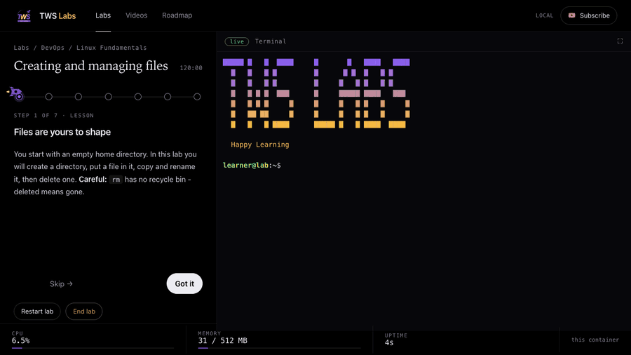
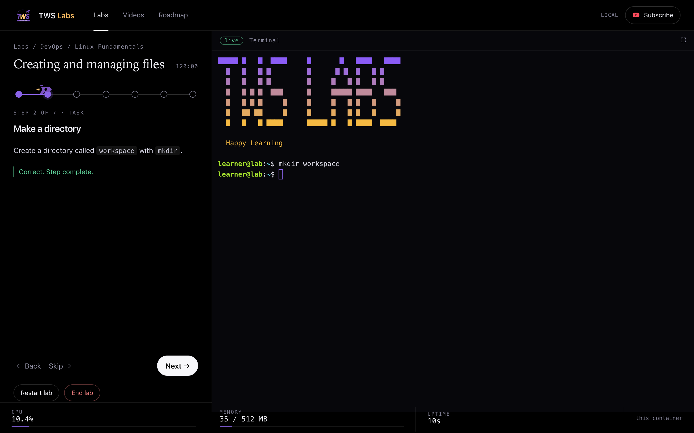
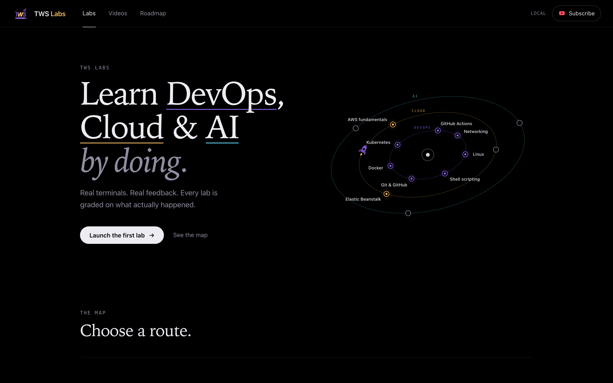
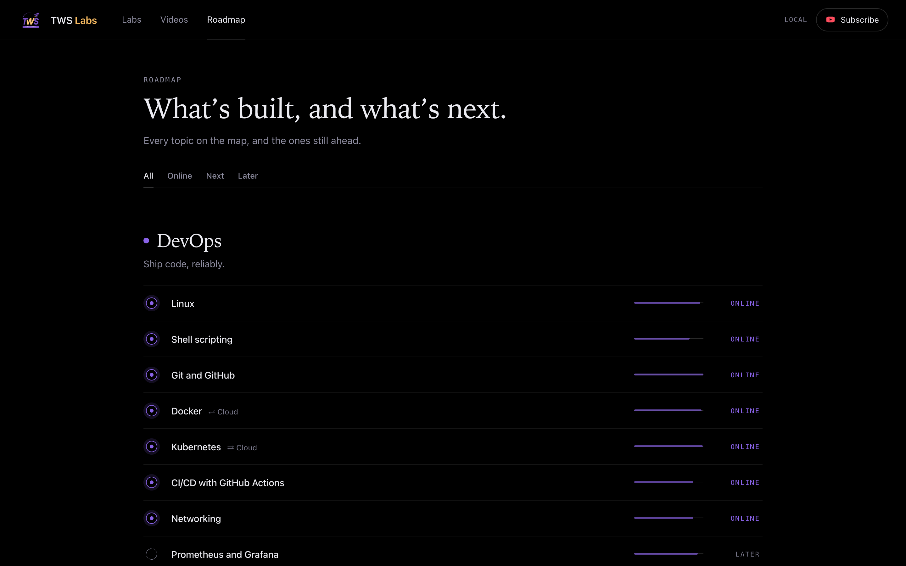
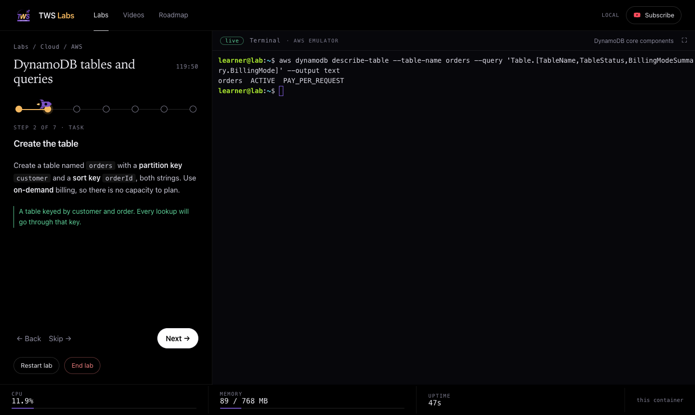

<div align="center">

# TWS Labs

**Learn DevOps, Cloud and AI by doing: a real terminal, real files, tasks graded on what actually happened.**

<!-- badges:start -->
[](https://github.com/TrainWithShubham/tws-labs/actions/workflows/ci.yml)
[](https://github.com/TrainWithShubham/tws-labs/releases)
[](LICENSE)
[](#whats-online)
[](#how-it-works)
[](#run-it-locally)
[](https://github.com/TrainWithShubham/tws-labs/stargazers)
<!-- badges:end -->

<!-- pitch:start -->
**54 labs · 271 graded tasks · every offline and emulator task proven solvable by a script.**
<!-- pitch:end -->



</div>

Not a quiz: each task runs a check script against the real state of a real Linux sandbox. Run it on your own
machine (**Windows, macOS or Linux**, one command, no account) or use the hosted version, which runs on [AWS Elastic Beanstalk](https://docs.aws.amazon.com/elasticbeanstalk/latest/dg/Welcome.html). Labs are plain YAML and shell scripts,
so anyone can contribute one. The syllabus is adapted from the TrainWithShubham DevOps roadmap (`labs/roadmap.json`).

## What's new in 1.5

- **AWS labs with no AWS account.** `EMULATOR=1 ./start_local_labs.sh` starts the labs with [AWS's own local emulator](docs/emulator-labs.md) beside them, and four new labs run the real `aws` CLI against it: **S3**, **DynamoDB**, **SQS and SNS**, and **CloudFormation**. No account, no keys, no cost, nothing to clean up.
- **Proven, not promised.** A new CI job runs every emulator lab against the real emulator (each check fails before its solution and passes after, wrong answers are rejected, valid alternatives accepted) and plays each one through the UI in real Chrome.
- **Honest about what an emulator is.** Each lab says what it models and what only real AWS enforces (IAM permissions for users and roles), and the track page tells you which AWS labs need no account.
- **Fixed for every AWS lab:** `aws s3 cp` no longer aborts in the lab terminal, and checks that wait for AWS get 30 seconds instead of 5.

<details>
<summary>Earlier releases</summary>

- **1.4: eleven labs and two tracks.** Kubernetes grows to ten labs (labels and selectors, probes and rolling updates, Ingress, Jobs and CronJobs, storage, namespaces), and **Helm** and **GitOps** arrive as tracks, graded on the files you write. Plus Git rebase and cherry-pick, shell functions, a Python JSON config lab, and *Linux in Action* rebuilt as an incident-response capstone.
- **1.3: Terraform, Python and the first AI lab.** A five-lab Terraform track, Python for DevOps, and *your first agent loop* against a scripted stand-in model (no GPU, no key). A hardening pass on the server, and commands you complete with Tab now count.
- **1.2: skip never dead-ends.** Jump past a task and the lab sets up the files the next one needs. Tiered hints, **Restart lab**, plain-words session ends, AA contrast, and optional usage counters for teams that self-host ([usage counters](#usage-counters-optional-off-by-default)).

</details>

Full details and upgrade notes: [CHANGELOG.md](CHANGELOG.md).

## Start here

| I want to... | Open |
|---|---|
| Get comfortable in a Linux terminal | [Linux Fundamentals](labs/linux-fundamentals) |
| Automate with Bash | [Shell scripting basics](labs/linux-fundamentals/shell-scripting-basics) |
| Learn Git properly | [Git basics](labs/git-basics) |
| Understand containers and write a good Dockerfile | [Docker](labs/docker) |
| Debug "it can't connect" problems | [Networking](labs/networking) |
| Learn Kubernetes manifests (no cluster needed) | [Kubernetes](labs/kubernetes) |
| Build a CI/CD pipeline | [CI/CD with GitHub Actions](labs/github-actions) |
| Write infrastructure as code | [Terraform](labs/terraform) and [your first CloudFormation stack](labs/aws/cloudformation-first-stack) |
| Package and ship Kubernetes apps | [Helm](labs/helm) and [GitOps with Argo CD](labs/gitops) |
| Practise AWS with no account (S3, DynamoDB, SQS and SNS, CloudFormation) | [AWS labs on the emulator](docs/emulator-labs.md): `EMULATOR=1 ./start_local_labs.sh` |
| Practise the AWS CLI on your own account | [AWS CLI first steps](labs/aws/aws-cli-first-steps) (needs [an AWS account](docs/aws-labs.md)) |
| Script with Python | [Python for DevOps](labs/python) |
| Build your first AI agent (no GPU, no key) | [AI agents](labs/ai) |
| See what AWS Elastic Beanstalk Cluster Mode really is | [Cluster Mode lab](labs/aws/elastic-beanstalk-cluster-mode) |

## What's online

<!-- routes:start -->
| Route | Online today (labs) | Next |
|---|---|---|
| **DevOps** | Linux (8) · Shell scripting (2) · Git and GitHub (7) · Docker (3) · Kubernetes (10) · CI/CD with GitHub Actions (5) · Networking (3) | — · +6 later |
| **Cloud** | Elastic Beanstalk Cluster Mode (1) · AWS fundamentals (3) · Terraform on AWS (5) · Compute and serverless (2) · Helm (1) · GitOps with ArgoCD (1) | — |
| **AI** | Python for DevOps (2) · Building AI agents (1) | Agentic AI for DevOps · MCP, tools and gateways · +2 later |
<!-- routes:end -->

## Run it locally

<p align="center"></p>

**You need one thing: [Docker](https://www.docker.com/products/docker-desktop/)** (Docker Desktop on Windows and macOS, Docker Engine on Linux). No Node, no accounts. It is the same image the hosted version runs on Elastic Beanstalk, so what you run is what we host.

```bash
git clone https://github.com/TrainWithShubham/tws-labs
cd tws-labs
./start_local_labs.sh
```

The first run builds the image (a few minutes); after that it starts in seconds. Your browser opens at **http://localhost:8080**. Press `Ctrl+C` to stop; everything you did in a lab is thrown away with its sandbox.

| Your machine | How to run it |
|---|---|
| **macOS** | Install and open Docker Desktop, then run the commands above in Terminal. |
| **Linux** | Install Docker Engine with the compose plugin (your user must be able to run `docker`), then run the commands above. |
| **Windows** | Install Docker Desktop (WSL2 backend, the default) and [Git for Windows](https://git-scm.com/download/win). Open **Git Bash** and run the commands above. Using WSL instead? Run them inside your WSL distro with Docker Desktop's WSL integration on. |

Options:

```bash
LABS_PORT=9090 ./start_local_labs.sh     # port 8080 is busy
NO_BROWSER=1 ./start_local_labs.sh       # don't open the browser
EMULATOR=1 ./start_local_labs.sh         # also run the AWS labs that need no account (the first build is large, about 1.6 GB)
AWS=1 ./start_local_labs.sh              # run the labs that use your own AWS account (see docs/aws-labs.md)
./start_local_labs.sh stop               # stop and clean up from another terminal
```

Prefer plain Compose? `docker compose up --build` does the same thing.

**Troubleshooting**
- *"Docker is installed but not running"*: open Docker Desktop and wait for it to say it is running, then run the script again.
- *`bad interpreter` or `\r` errors on Windows*: Git converted line endings. The repo's `.gitattributes` prevents this on a fresh clone; if you cloned before that, run `git rm --cached -r . && git reset --hard`.
- *Permission denied on Linux*: add yourself to the docker group (`sudo usermod -aG docker $USER`, then log out and in), or run `chmod +x start_local_labs.sh`.
- *Port in use*: pick another with `LABS_PORT`.

## What you get

- **A lab page that helps without giving the answer.** Lesson on the left, a live Linux terminal on the right. A miss gets an amber nudge, then up to three tiers of hints; a pass turns green with a short confirmation.
- **Never stuck.** **Skip** and the step dots work: the lab prepares the files a later task needs. **Restart lab** starts over with fresh files. Your progress (tasks and labs) stays in your browser.
- **Honest checks.** Each task is graded on real state, and CI proves it three ways: the check fails before the solution and passes after, it rejects wrong-but-plausible answers and accepts valid alternatives, and the whole lab is played through the real server.
- **Accessible.** AA contrast, a visible focus ring, a skip link, and `Shift+Tab` leaves the terminal.

The home page is a quiet map of three routes; the roadmap lists every topic and its status.

<p align="center"> </p>

## How it works

```
 browser ── lesson pane + xterm.js terminal
    │  HTTP + WebSocket
 container ── node server ──▶ a real bash (node-pty) per session, as its own unprivileged user
                  └─ "Check" runs the step's checks/<id>.sh against that sandbox
                     (files? git state? your shell's cwd? a running process?)   exit 0 = pass
```

- **Track → Lab → Steps.** A step is a *lesson* (read) or a *task* (do something, press Check).
- **One engine, two profiles.** `LAB_PROFILE=local` (compose) is loopback-only with relaxed limits and works fully offline.
  The default `hosted` profile adds per-IP seat limits, tight timeouts and a same-origin guard for the public deployment (`deploy/`).
- **Safety.** Each session is a separate unprivileged user with a private home; the container drops all capabilities it doesn't need,
  has CPU/memory/PID limits and a read-only root; requests must come from the page itself (a website you visit can't drive your shell);
  the answers (`solutions/`) are unreadable from inside a lab.
- **Invite codes.** On the hosted deployment every lab needs an invite code (the pages stay public); the local app never asks.
  See `deploy/README.md`.
- **Progress** (which labs you finished) lives in your browser's localStorage. No accounts.

### Practising AWS: two ways

| | **No account: the AWS Emulator** | **Your own account** |
|---|---|---|
| Start with | `EMULATOR=1 ./start_local_labs.sh` | `AWS=1 ./start_local_labs.sh` |
| What runs | The real `aws` CLI against [AWS's own local emulator](docs/emulator-labs.md), in a container beside the labs | The real `aws` CLI against your account (a free-tier footprint, a graded cleanup, a role template with a budget alarm) |
| Cost and cleanup | None: it is forgotten when it stops | Pennies, and you clean up |
| Labs | S3, DynamoDB, SQS and SNS, CloudFormation | AWS CLI first steps, Elastic Beanstalk Cluster Mode |
| Proven in CI | Yes, against the real emulator | By hand, on a real account |
| Good for | Configuration and state: buckets, tables, queues, stacks | What an emulator cannot model, like IAM permissions and denials |

Both run only on your machine. The hosted site shows these labs read-only and never asks for keys. More: [docs/emulator-labs.md](docs/emulator-labs.md) and [docs/aws-labs.md](docs/aws-labs.md).

<p align="center"></p>

### Usage counters (optional, off by default)
Self-hosting teams can count how the labs are used: `USAGE_STATS=1` records sessions per lab, distinct visitors per day and which
tasks learners fail. It never stores an IP address or an invite code. Add `ADMIN_TOKEN=<secret>` to read it at
`/admin/stats` (`curl -H "Authorization: Bearer <secret>" http://localhost:8080/admin/stats`), and `USAGE_DIR=<a mounted folder>`
to keep the counts across restarts. The page also lists the **hardest tasks** (lowest pass rate over at least 5 attempts), a good way to find a vague task or an unfair check.

## Community labs

Labs written by people outside the core team. Thank you.

| Lab | Author | PR |
|---|---|---|
| Linux in Action (Linux Fundamentals) | [@Heyyprakhar1](https://github.com/Heyyprakhar1) | [#14](https://github.com/TrainWithShubham/tws-labs/pull/14) |
| Artifacts and caching (CI/CD with GitHub Actions) | [@cloudwithpreetham](https://github.com/cloudwithpreetham) | [#26](https://github.com/TrainWithShubham/tws-labs/pull/26) |
| Ignoring files with .gitignore (Git and GitHub) | [@srdangat](https://github.com/srdangat) | [#27](https://github.com/TrainWithShubham/tws-labs/pull/27) |
| Pod and Deployment anatomy (Kubernetes) | [@cloudwithpreetham](https://github.com/cloudwithpreetham) | [#35](https://github.com/TrainWithShubham/tws-labs/pull/35) |
| Text processing with awk and sed (Linux Fundamentals) | [@srdangat](https://github.com/srdangat) | [#32](https://github.com/TrainWithShubham/tws-labs/pull/32) |
| Exposing Pods with Services (Kubernetes) | [@srdangat](https://github.com/srdangat) | [#42](https://github.com/TrainWithShubham/tws-labs/pull/42) |
| Process management (Linux Fundamentals) | [@techwithiishaq](https://github.com/techwithiishaq) | [#45](https://github.com/TrainWithShubham/tws-labs/pull/45) |
| Git stash (Git and GitHub) | [@srdangat](https://github.com/srdangat) | [#69](https://github.com/TrainWithShubham/tws-labs/pull/69) |
| Reusable workflows (CI/CD with GitHub Actions) | [@srdangat](https://github.com/srdangat) | [#70](https://github.com/TrainWithShubham/tws-labs/pull/70) |
| Production incident triage (Linux Fundamentals) | [@cloudwithpreetham](https://github.com/cloudwithpreetham) | [#67](https://github.com/TrainWithShubham/tws-labs/pull/67) |
| Resolving merge conflicts (Git and GitHub) | [@Rakesh-Patra](https://github.com/Rakesh-Patra) | [#68](https://github.com/TrainWithShubham/tws-labs/pull/68) |
| Terraform track, five labs (Terraform) | [@Heyyprakhar1](https://github.com/Heyyprakhar1) | [#71](https://github.com/TrainWithShubham/tws-labs/pull/71) |
| Persistent storage (Kubernetes) | [@srdangat](https://github.com/srdangat) | [#82](https://github.com/TrainWithShubham/tws-labs/pull/82) |
| Namespaces (Kubernetes) | [@srdangat](https://github.com/srdangat) | [#88](https://github.com/TrainWithShubham/tws-labs/pull/88) |
| Linux in Action, rebuilt as an operations capstone (Linux Fundamentals) | [@Heyyprakhar1](https://github.com/Heyyprakhar1) | [#87](https://github.com/TrainWithShubham/tws-labs/pull/87), shipped as [#90](https://github.com/TrainWithShubham/tws-labs/pull/90) |

## Contributing and security

Contributions are welcome, labs most of all: start with [CONTRIBUTING.md](CONTRIBUTING.md). To report a vulnerability, follow
[SECURITY.md](SECURITY.md) (please don't open a public issue). The hosted version asks for an invite code; the local app never does.

Want your lab in the table above? Pick a topic from the [roadmap](labs/roadmap.json) and follow [CONTRIBUTING.md](CONTRIBUTING.md).

## Add your own lab

No JavaScript needed — see [CONTRIBUTING.md](CONTRIBUTING.md) and [docs/authoring.md](docs/authoring.md).

```bash
node scripts/new-lab.js linux-fundamentals my-lab "My lab title"        # scaffold (needs Node on the host)
# edit labs/linux-fundamentals/my-lab/{lab.yaml,checks,solutions}; refresh the browser to try it
docker compose run --rm labs node scripts/validate-labs.js --strict     # proves every task is solvable
```

## Roadmap and videos

`/roadmap` lists every topic by route, with its status and sub-topics; `/videos` collects the matching TrainWithShubham walkthroughs. Both are
built from `labs/roadmap.json`: change a topic's `status` or add a topic there, no code needed. A validator keeps it honest: a topic can only be
*live* if real labs sit behind it, and every lab must appear on the roadmap.

## Repo map

| Path | What |
|---|---|
| `labs/` | All lab content (`<track>/<lab>/{lab.yaml,setup.sh,checks/,solutions/}`), `roadmap.json` (syllabus + status), `site.yaml`, `lib.sh` (check helpers) |
| `src/` | The server: sessions, sandbox, loader, profiles, header/pages |
| `public/` | Browser code and the stylesheets |
| `start_local_labs.sh` | One-command local start for macOS, Linux and Windows (Git Bash / WSL); `AWS=1` and `EMULATOR=1` add the AWS overlays (`docker-compose.aws.yml`, `docker-compose.emulator.yml`, `Dockerfile.emulator`) |
| `scripts/` | `validate-labs.js` (the contribution gate: fail-before/pass-after, `cases/`, skip-ahead), `lint-labs.js`, `new-lab.js`, `check-hygiene.js`, `record-demo.js` (re-records the README GIF), AWS helpers |
| `test/` | `unit/` and `integration/` (the integration tests spawn real shells; they need Linux, i.e. the image) and `e2e/` (real-Chrome browser tests) |
| `deploy/` | Hosted deployment on AWS Elastic Beanstalk Cluster Mode: Terraform, deploy scripts, smoke test |
| `docs/` | Authoring guide, the AWS-labs and [emulator-labs](docs/emulator-labs.md) guides, Elastic Beanstalk research notes |

## Tests

```bash
npm ci && npm run test:unit          # fast, anywhere
npm run lab:check -- <track>/<lab>   # prove one lab: fail-before/pass-after, cases, skip-ahead
./start_local_labs.sh && npm run e2e  # real-Chrome browser tests against the running app
EMULATOR=1 ./start_local_labs.sh && npm run e2e   # the same, plus every emulator lab played through the UI
docker compose run --rm -v "$PWD/test:/app/test:ro" labs sh -c 'node --test --test-force-exit test/unit/*.test.js test/integration/*.test.js'
```

## License

Code, labs and docs are released under the [MIT License](LICENSE). The TWS Labs name and logo (`public/logo/`) are not covered by it:
please don't use them to suggest your fork is the official one. The lab answers in `labs/**/solutions/` are public on purpose;
the hosted image keeps them out of the learner's shell, and the local app is for learning, not exams.
